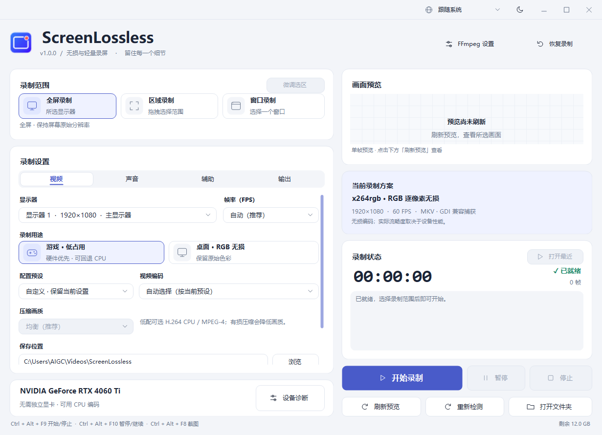
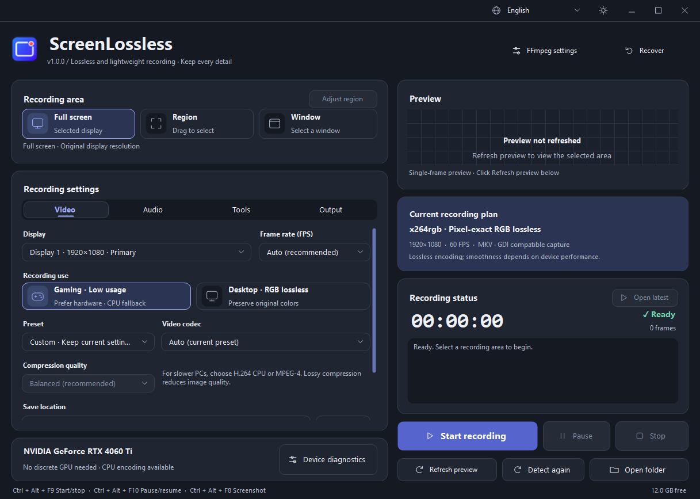

# ScreenLossless v1.0.0

**中文** | [English](README.en.md)

适用于 Windows 10/11 x64 的屏幕录制工具。支持全屏、区域、窗口录制，提供 RGB 无损与轻量压缩编码，以及系统声音和麦克风采集。

**[下载 Windows 单 EXE 版（推荐，79.6 MiB）](https://github.com/AIBOT-labs/ScreenLossless/releases/download/v1.0.0/ScreenLossless_v1.0.0_Win64_Standalone.exe)**

[全部版本与校验文件](https://github.com/AIBOT-labs/ScreenLossless/releases/tag/v1.0.0) · [FFmpeg 对应源码](https://github.com/AIBOT-labs/ScreenLossless/releases/download/v1.0.0/ScreenLossless_FFmpeg_9.0.2_Source.zip)

## 界面预览

白天模式 · 中文界面

查看黑夜模式与英文界面

## 下载

[前往 v1.0.0 发行页面](https://github.com/AIBOT-labs/ScreenLossless/releases/tag/v1.0.0)

| 版本 | 大小 | 运行方式 | 下载与校验 |
| --- | --- | --- | --- |
| **Standalone · 推荐** | 79.6 MiB | 单 EXE 直接打开，无需另装 .NET | [EXE](https://github.com/AIBOT-labs/ScreenLossless/releases/download/v1.0.0/ScreenLossless_v1.0.0_Win64_Standalone.exe) · [SHA256](https://github.com/AIBOT-labs/ScreenLossless/releases/download/v1.0.0/ScreenLossless_v1.0.0_Win64_Standalone.exe.sha256) |
| Portable · 便携版 | 74.0 MiB | 完整解压后运行，内置 .NET | [ZIP](https://github.com/AIBOT-labs/ScreenLossless/releases/download/v1.0.0/ScreenLossless_v1.0.0_Win64_Portable.zip) · [SHA256](https://github.com/AIBOT-labs/ScreenLossless/releases/download/v1.0.0/ScreenLossless_v1.0.0_Win64_Portable.zip.sha256) |
| Compact · 精简版 | 11.1 MiB | 需 .NET 8 Desktop Runtime x64 | [ZIP](https://github.com/AIBOT-labs/ScreenLossless/releases/download/v1.0.0/ScreenLossless_v1.0.0_Win64_Compact.zip) · [SHA256](https://github.com/AIBOT-labs/ScreenLossless/releases/download/v1.0.0/ScreenLossless_v1.0.0_Win64_Compact.zip.sha256) |
| FFmpeg 对应源码 | 41.6 MiB | 与三个运行版本匹配的源码和构建材料 | [源码 ZIP](https://github.com/AIBOT-labs/ScreenLossless/releases/download/v1.0.0/ScreenLossless_FFmpeg_9.0.2_Source.zip) · [SHA256](https://github.com/AIBOT-labs/ScreenLossless/releases/download/v1.0.0/ScreenLossless_FFmpeg_9.0.2_Source.zip.sha256) |

希望只下载一个文件，选择 **Standalone 单 EXE 版**，双击即可运行，不需要另外安装 .NET。首次运行会自动将内置录制组件准备到当前用户缓存，后续复用；程序旁不需要其他文件。详见[单 EXE 版说明](docs/Standalone-README.md)。

Portable 完整解压后打开 `ScreenLossless.exe`，保留旁边的 FFmpeg、ffprobe 和运行所需文件。Compact 需要安装 .NET 8 Desktop Runtime x64。三个版本功能相同。

GitHub 的源码仓库和自动生成的 **Source code ZIP** 不包含编译好的软件。下载源码后需要自行构建，不能直接当作便携版运行。

## 快速开始

1. 选择全屏、区域或窗口。首次启动默认全屏；再次启动恢复上次模式和有效选区。
2. 在「视频」页选择帧率、预设、编码与保存位置。无独立显卡时可选 CPU 编码。
3. 按需在「声音」页启用系统声音、麦克风和混音，在「输出」页选择尺寸、MKV/MP4 与分段规则。
4. 点击「开始录制」。通过浮窗暂停、继续或停止，停止后等待合成保存完成。
5. 使用「打开最近」或「打开文件夹」查看文件；中断或合成失败的素材可通过「恢复录制」处理。

在本地已构建的项目目录，也可双击 `Start-ScreenLossless.bat`，它会启动 `releases/v1.0.0/Portable/ScreenLossless.exe`。

## 界面语言

窗口右上角提供「跟随系统」「中文」和「English」：

- 默认跟随 Windows 显示语言：简体或繁体中文系统使用中文，其他系统使用英文。
- 手动选择会被记住，空闲时立即生效；选择跟随系统可恢复自动判断。
- 主界面、设置、编码选项、窗口选择、恢复界面、录制浮窗及应用提示支持双语。设备名称、窗口标题、文件名和路径保留原文。
- 录制、倒计时和文件处理期间暂不能切换语言。切换会保留录制设置、选区、当前设置页、最近文件和窗口状态。

本页为中文项目说明；点击顶部 **English** 阅读完整英文版。

## 白天与黑夜模式

右上角语言选项旁只有一个主题按钮：白天显示月亮，点击切换到黑夜；黑夜显示太阳，点击切回白天。首次使用为白天模式，选择会被记住。主界面、设置页、菜单、弹窗、滚动条和录制浮窗使用统一配色；录制和暂停时也可切换，不会重启编码器。

## 功能

- **录制范围**：全屏、区域、窗口；记住上次模式与区域，外侧深浅双层虚线支持移动和缩放，区域内部鼠标穿透。
- **浮动控制**：显示倒计时、开始时间与有效录制时长，提供暂停、继续、停止和返回主界面。
- **多种编码**：CPU 无损与轻量压缩，NVIDIA H.264/HEVC、Intel QSV、AMD AMF；硬件可用性通过本机试编码判断。
- **声音采集**：系统声音、麦克风，支持混音或独立音轨；设备断开时补静音并尝试重连。
- **输出与保护**：MKV/MP4、尺寸缩放、连续保护分段、定时停止、磁盘空间保护和中断恢复。
- **桌面操作**：单帧预览、截图、自定义全局快捷键、多显示器及混合 DPI 支持。

## 编码与画质

| 编码方案 | 用途与画质说明 |
| --- | --- |
| H.264 x264rgb / FFV1 · CPU | 原始尺寸下保留 RGB 像素，适合需要逐像素保真的录制；不需要独立显卡 |
| H.264 NVIDIA · 4:4:4 无损 | 保留编码后的 YUV 数据；RGB 色彩转换不保证逐像素可逆 |
| HEVC NVIDIA · 10-bit 4:4:4 编码无损 | 单独验证 Rext、10-bit、4:4:4、BT.709 全范围和编码前后 YUV 一致性；不等同于 RGB 原像素或 HDR 捕获 |
| H.264 CPU / MPEG-4 CPU | 轻量有损压缩，适合性能较低的电脑，可配合较低帧率或输出尺寸 |
| 常规 NVIDIA H.264/HEVC、Intel QSV、AMD AMF | 硬件有损压缩，实际可用性取决于硬件、驱动和 FFmpeg |

自动选择置顶，可用选项从轻量压缩到高保真无损排列，不可用选项位于列表底部。当前捕获源为 **8-bit SDR**；10-bit 编码不代表原生 10-bit 桌面或 HDR 捕获。缩放会改变原始像素。更完整的说明见[使用说明](docs/UserGuide.md)。

## 适用范围与限制

适合需要可调整区域、暂停继续、显式无损编码选项和 CPU 回退的本地录屏。

- 兼容捕获和现代窗口捕获各有适用条件。目标窗口关闭、最小化或改变尺寸时，会尝试停止并保存已有内容。
- 自动降帧通过重启编码器完成，可能有短暂间隔；不自动降低分辨率。分段大小是分组目标，不是每个文件的严格上限。
- 各型号 NVIDIA / Intel / AMD 显卡、实体声卡热插拔、数小时音画同步和混合 DPI 多屏仍需要对应实机验证。本项目不承诺零掉帧或支持所有硬件，验证方法见[硬件验证范围](docs/HARDWARE-VALIDATION.md)。

## 文档

- [完整使用说明](docs/UserGuide.md)
- [运行资源与性能](docs/PERFORMANCE.md)
- [硬件验证范围](docs/HARDWARE-VALIDATION.md)
- [开源检查](docs/OPEN-SOURCE-REVIEW.md)
- [第三方声明](docs/THIRD-PARTY-NOTICES.md)
- [图标来源](docs/ASSETS.md)
- [开发与目录维护](docs/DEVELOPMENT.md)
- [FFmpeg 对应源码与分发](docs/FFmpeg-SOURCE.md)
- [GitHub 发布步骤与上传文件](docs/GITHUB-PUBLISH.md)

开发与目录说明

## 开发

应用使用 C# / WinForms、FFmpeg 和 NAudio 构建。开发需要 **.NET 8 SDK**。项目文件位于 `src/ScreenLossless.csproj`。GitHub 源码仓库不包含本机的 `releases/` 与 `.tools/`；构建脚本会复用已有的本机 SDK 和依赖缓存。

| 操作 | 命令 |
| --- | --- |
| 编译应用并生成运行包 | `scripts/build-windows-x64.bat` |
| 从源码运行 | `scripts/run-source-windows.bat` |
| 安装配套 FFmpeg | `scripts/download-ffmpeg.bat` |
| 功能回归 | `powershell -ExecutionPolicy Bypass -File tests/Run-Regression.ps1` |
| 中英文与设置保留检查 | 上述回归命令加 `-Localization` |
| 连续切换与主消息循环检查 | 上述回归命令加 `-LanguageContext` |
| 日夜主题、记忆与录制中切换检查 | 上述回归命令加 `-Themes` |
| 主窗口与浮窗检查 | 上述回归命令加 `-MainContext` |

也可运行 `powershell -ExecutionPolicy Bypass -File scripts/build.ps1`。发布输出集中在 `releases/v1.0.0/` 与 `releases/packages/`；编译中间文件在 `.tools/build/`，测试录像和截图在 `tests/artifacts/`，均已被 Git 忽略。

自行编译 FFmpeg 需要 Linux Docker 和 Python。使用现成的运行包不需要这些开发工具。

## 目录说明

| 目录 | 内容 |
| --- | --- |
| `src/` | 应用源码和项目文件，按界面、录制、音频、编码、捕获等模块分类 |
| `releases/v1.0.0/` | 本地 Standalone / Portable / Compact 运行目录，不进入源码仓库 |
| `releases/packages/` | 本地运行 ZIP、FFmpeg 对应源码 ZIP 与 SHA256 |
| `docs/` | 使用说明、验证方法、开源和分发说明 |
| `scripts/` | 编译、源码启动与 FFmpeg 获取和构建脚本 |
| `tests/` | 回归脚本、测试项目与 `Cases/` 测试源码 |
| `assets/` | 应用图标、图标源图像和界面截图 |
| `licenses/` | .NET、NAudio 等第三方许可证 |
| `third_party/` | FFmpeg 固定版本源码材料和构建方法 |
| `.tools/` | 本机 SDK、依赖与构建缓存，不进入源码仓库 |
| `.github/` | GitHub Actions 构建配置 |

## 许可证与分发

应用源码采用 [MIT 许可证](LICENSE)。FFmpeg 是独立运行的 GPL-3.0-or-later 程序；NAudio、.NET 等组件保留各自许可证，详见[第三方声明](docs/THIRD-PARTY-NOTICES.md)。

Standalone 将运行环境和录制组件合入一个 EXE；Portable 内置压缩的 .NET 环境，Compact 使用电脑已安装的运行环境。FFmpeg 仅编译本软件需要的模块，对应源码作为独立 ZIP 提供，避免在每个运行包中重复携带。

发布 GitHub Release 时，将 **Standalone EXE、两个运行 ZIP、FFmpeg 完整对应源码 ZIP 和各自的 SHA256** 一起提供，并在运行包链接旁列出对应源码链接。离线再次分发时一并交付源码 ZIP，保留许可证与署名。具体材料和分发方式见 [FFmpeg 源码分发说明](docs/FFmpeg-SOURCE.md)。
